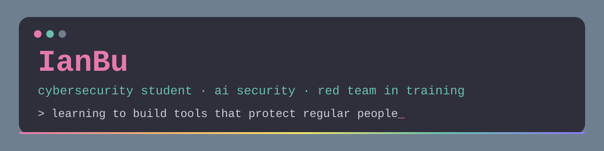

### hi, i'm ian (they/them) 🐰

cybersecurity student working toward **ai security & red teaming**.
i care about protecting regular people from phishing, data theft, and manipulation.

#### 🔧 currently
- studying for my B.S. in Computer Science – Cybersecurity Engineering
- writing my own code, one small project at a time
- designing a tool that detects when a livestream has been edited

#### 🧠 interested in
`ai security` · `red teaming` · `privacy` · `digital forensics` · `linux`

#### 📂 projects
coming soon — each one with a README on what it does, how it works, and what i'd improve.

ship it, patch later.
